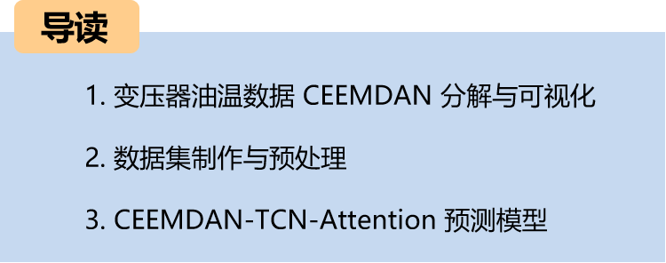
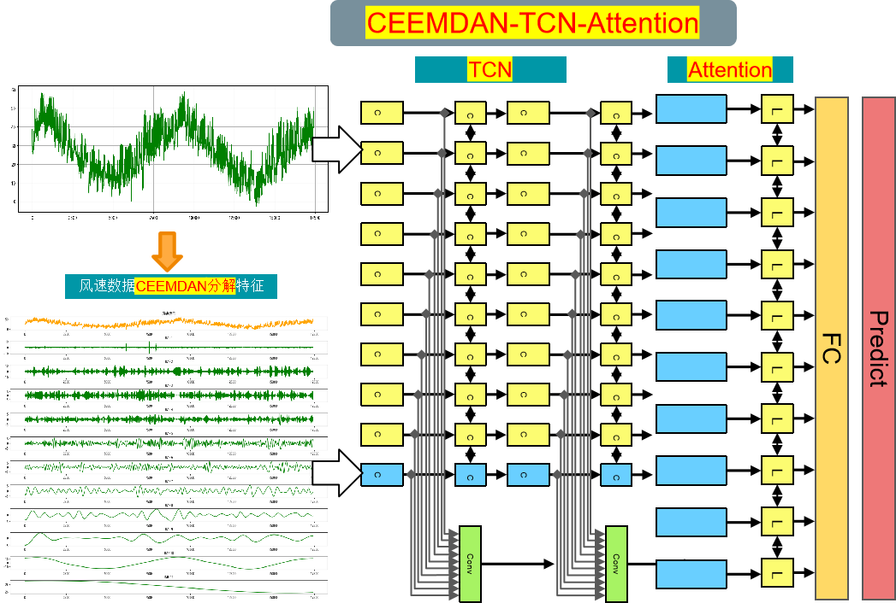
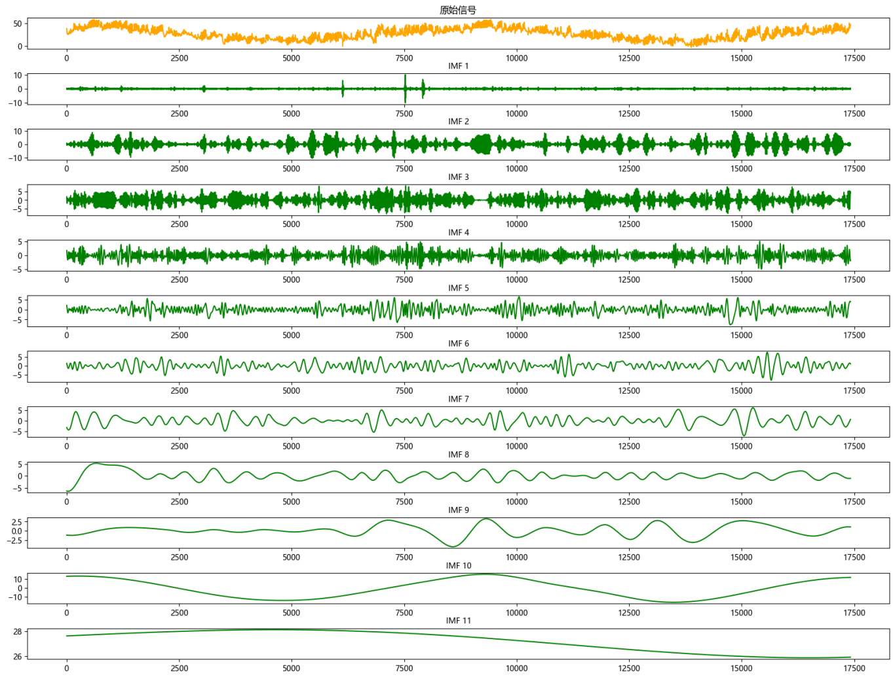
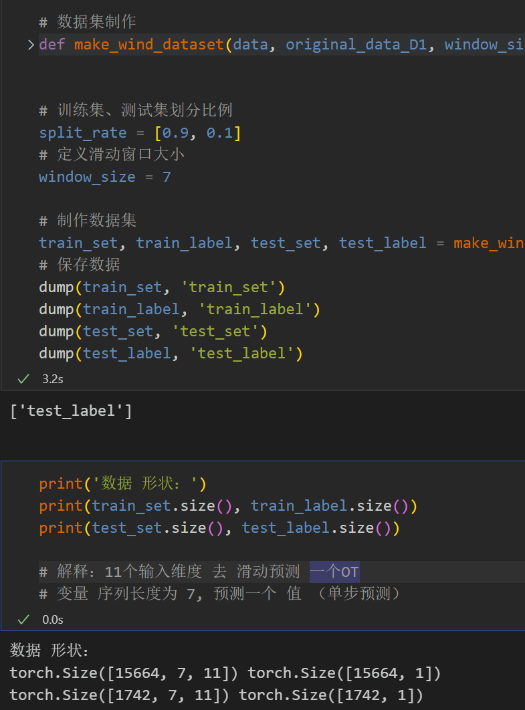
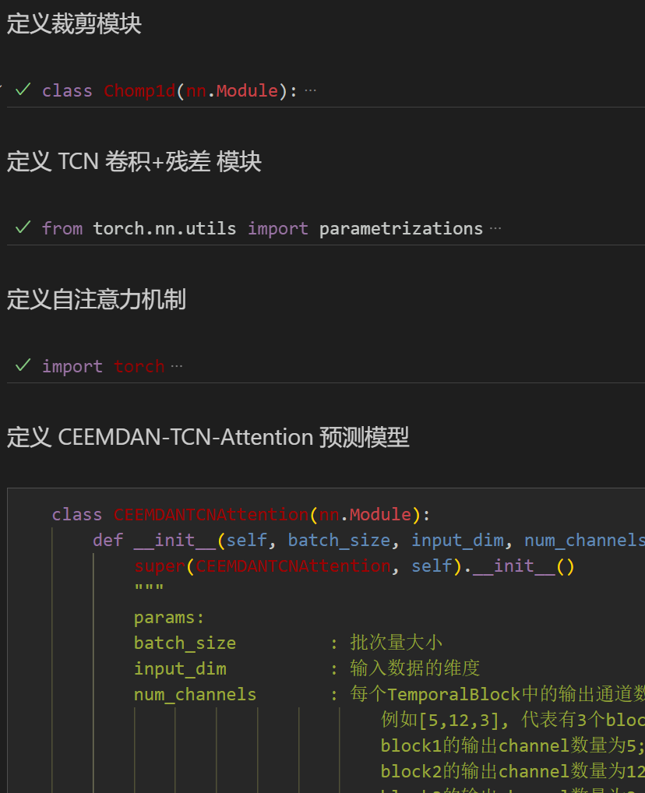
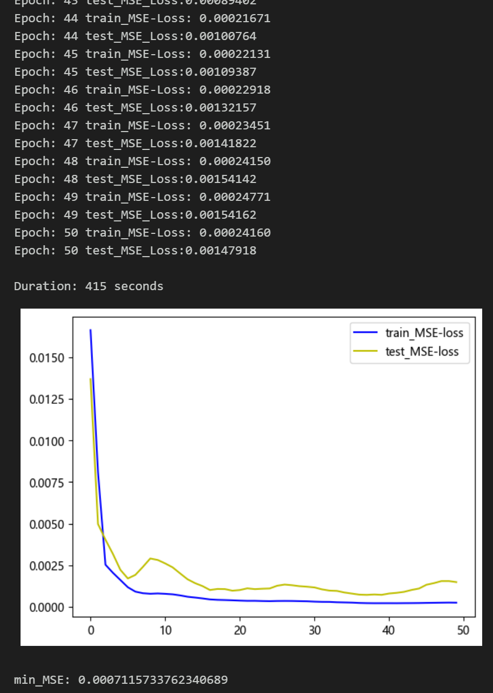
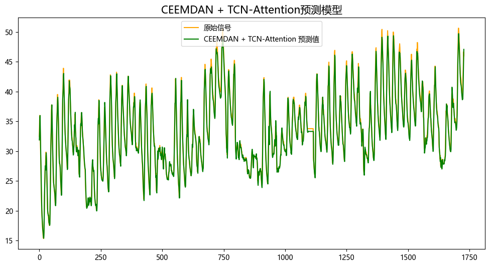
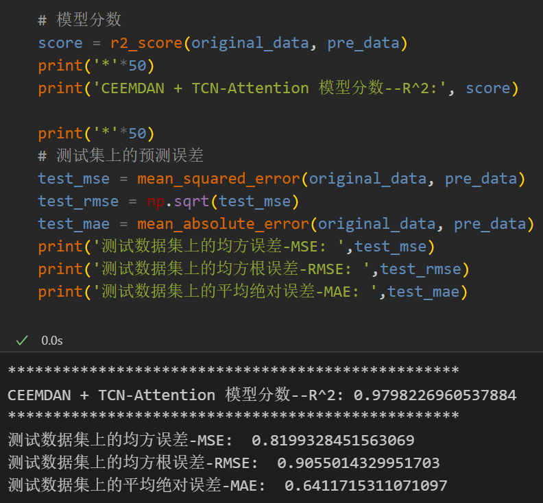
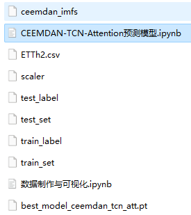

# Stepwise Prediction (Part 8) CEEMDAN-TCN-Attention Prediction Model

Multi-feature variables include the following:
Preface
This paper introduces a method for comprehensive application of the Complete Ensemble Empirical Mode Decomposition (CEEMDAN) and TCN-Attention prediction model to improve the predictive performance of time series data. The detailed introduction to the power transformer dataset can be found in the following text:
Introduction to Power Transformer Dataset and Preprocessing
The overall structure of the model: use the CEEMDAN algorithm to decompose wind speed sequences into component features, input them into a sliding window dataset for predicting wind speed. Through the TCN-Attention model, extract component space and temporal features, then feed them into a fully connected layer to achieve a high-precision prediction model.
1. Power Transformer Data CEEMDAN Decomposition and Visualization
1.1 Import Data
1.2 CEEMDAN Decomposition
2. Dataset Preparation and Preprocessing
Divide the dataset into training set and test set at a ratio of 9:1
3. TCN-Attention Model Prediction Based on CEEMDAN
3.1 Define CEEMDAN-TCN-Attention Prediction Model
Note: The shape of the input wind speed data is [64, 7, 11], batch_size=64, where 7 represents the sequence length (the sliding window takes values), and dimension 11 represents 11 components.
3.2 Set parameters and train the model
Train the model for 100 epochs, with MSE as 0.0372, the CEEMDAN-TCN-Attention prediction effect is good, and appropriate adjustment of model parameters can further improve the model prediction performance.
Note: Adjust parameters:
- You may increase the number of TCN layers and each layer's dimension, adjust learning rate;
- Adjust the number of attention dimensions, increase more epochs (note to prevent overfitting);
\tThe sliding window length can be changed (set the appropriate window length).
\t  
4 Results Visualization and Model Evaluation
4.1 Result Visualization
4.2 Model Evaluation
\t  
Previously Featured Content:
Time Series Forecasting: Analysis and comparison of LSTM, ARIMA, Holt-Winters, SARIMA models
Wind Speed Prediction (Part 1) Data Set Introduction and Preprocessing
Wind Speed Prediction (II) EMD-LSTM Model Based on Pytorch
Wind Speed Prediction (III) EMD-LSTM-Attention Model
Wind Speed Prediction (IV) EMD-Transformer Model Based on Pytorch
Wind Speed Prediction (5) EMD-CNN-LSTM Model Based on Pytorch
Wind Speed Prediction (VI) - EMD-CNN-GRU Parallel Model Based on Pytorch
CEEMDAN + Combination Forecasting Model (BiLSTM-Attention + ARIMA)
CEEMDAN + Combination Forecasting Model (CNN-LSTM + ARIMA)
CEEMDAN + Combination Forecasting Model (Transformer - BiLSTM + ARIMA)
CEEMDAN + Combination Forecasting Model (CNN-Transformer + ARIMA)
Multi-feature Variable Sequence Prediction (I) - CNN-LSTM Wind Speed Prediction Model
Multi-feature Variable Sequence Prediction (II) - CNN-LSTM-Attention Wind Speed Prediction Model
Multi-feature Variable Sequence Prediction (III) - CNN-Transformer Wind Speed Prediction Model
Multi-feature Variable Sequence Prediction (IV) - Transformer-BiLSTM Wind Speed Prediction Model
Multi-feature Variable Sequence Prediction (V) CEEMDAN+CNN-LSTM Wind Speed Prediction Model
Multi-feature Variable Sequence Prediction (6) CEEMDAN+CNN-Transformer Wind Speed Prediction Model
Prediction Model Based on the Swarm Optimization Algorithm SSA: CEEMDAN-BiLSTM-Attention
Prediction Model Based on the Swarm Optimization Algorithm SSA: CEEMDAN-Transformer-BiGRU
Superior Prediction Model: Secondary Decomposition-Combination Prediction
Multi-feature Variable Sequence Prediction (7) CEEMDAN+Transformer-BiLSTM Prediction Model
Multi-feature Variable Sequence Prediction (8) Prediction Model Based on the Swarm Optimization Algorithm for CEEMDAN-SSA-BiLSTM
Multi-feature Variable Sequence Prediction (11) TCN-GRU Prediction Model Based on Pytorch
VMD + CEEMDAN Secondary Decomposition, CNN-LSTM Prediction Model
VMD + CEEMDAN Secondary Decomposition, CNN-Transformer Prediction Model
Prediction Model Based on the Swarm Optimization Algorithm SSA: Code All-in-One

## Images

<!-- PAYMENT_BLOCK -->

## Get this dataset

- Payment link (Stripe): [Buy now](https://buy.stripe.com/3cs8yP7sY87d0vu9AB)
- Payment QR code: 

<!-- /PAYMENT_BLOCK -->
